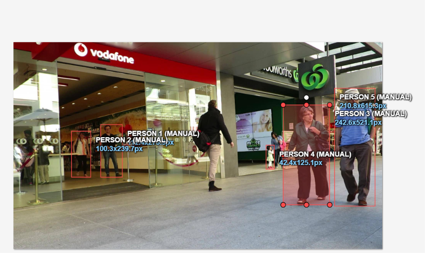
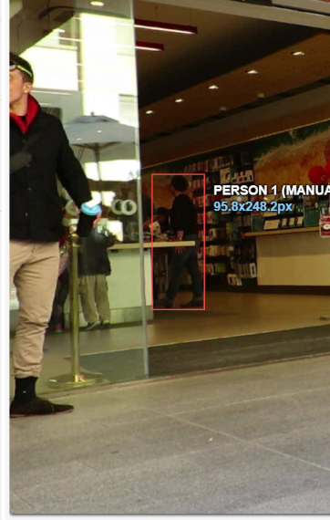
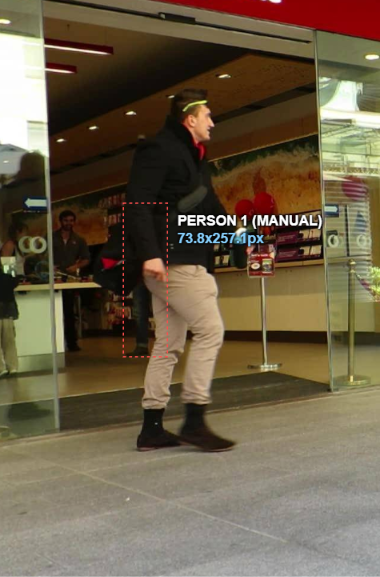
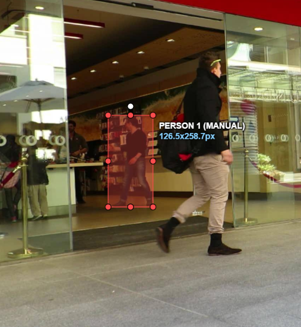

# Báo cáo cá nhân — NguyenTanDung-2A202603031

Đoạn video: **MOT17-09**, 150 frame (CVAT đánh số 0–149), nguồn MOTChallenge, giấy phép CC BY-NC-SA 3.0 (theo mẫu báo cáo).

> **Thông tin bổ sung:** Mã đề **A**; thời gian thực hiện **16:30–19:00 ngày 13/11/2026**; job CVAT đã **Completed** (theo xác nhận của học viên).

> **Quy ước số liệu:** Thống kê theo track CVAT 0–4 vì log kiểm tra không cung cấp bảng đối chiếu ID CVAT với P1–P5. Không tự suy ra phép ánh xạ giữa hai hệ ID. Frame CVAT bắt đầu từ 0; frame MOT bắt đầu từ 1.

## 0. Thông tin học viên

- Họ tên: **Nguyễn Tấn Dũng**
- MSSV: **2A202603031**
- Mã đề (A/B/C): **A**
- Email: Không cung cấp trong dữ liệu báo cáo.
- Link repository: https://github.com/dt2576/K5-L2-DAY05-NguyenTanDung-2A202603031-MOTTracking
- Giờ bắt đầu: **16:30, ngày 13/11/2026**
- Giờ kết thúc: **19:00, ngày 13/11/2026**

## 1. Xem trước đoạn video (CP0)

Đoạn video MOT17-09 gồm 150 frame, từ 0 đến 149 trên CVAT (30 FPS). Ảnh tổng quan cho thấy năm nhãn `PERSON 1` đến `PERSON 5` trong cùng cảnh. Các số liệu dưới đây lấy từ bản export CVAT và dùng **ID nội bộ CVAT** để tránh gán nhầm người.

| Track CVAT | Frame đầu có box | Frame cuối có box | Đoạn vắng (`outside`) | Occluded (số frame) | Ghi chú |
|---|---:|---:|---|---:|---|
| 0 | 0 | 149 | Không | 25 | Xuất hiện xuyên suốt |
| 1 | 60 | 149 | Không | 0 | Xuất hiện từ frame 60 |
| 2 | 0 | 149 | Không | 0 | Xuất hiện xuyên suốt |
| 3 | 0 | 148 | 112–134 | 20 | Có box trở lại ở frame 135 |
| 4 | 0 | 149 | Không | 27 | Xuất hiện xuyên suốt |

Mốc rẽ, dừng và đổi tốc độ không được thống kê trong kết quả checker, nên không gán số frame cụ thể khi không có dữ liệu. Việc nhận diện đúng P1–P5 phụ thuộc bảng phân công của đề A, không thể chứng minh bằng riêng số ID CVAT trong log.

**Ảnh tổng quan năm người được gán nhãn:**



Thời gian thực hiện: **16:30–19:00 ngày 13/11/2026**, tổng **150 phút**.

## 2. Keyframe và thời gian (CP1, CP4)

Dữ liệu lấy nguyên từ đầu ra `src/check_submission.py`. Do chưa có bản đối chiếu mã P1–P5, dùng ID CVAT để định danh chính xác các hàng. Thời gian chỉ được ghi nhận cho toàn bài, không tự phân bổ theo track.

| Mã | Số keyframe | Keyframe ở frame | Số frame có mặt | Keyframe / 100 frame | Thời gian (phút) | Chỗ khó |
|---|---:|---|---:|---:|---|---|
| Track CVAT 0 | 116 | 0, 1, 2, 3, 4, 6, 7, 8, 9, 10, 11, 12, 13, 14, 15, 16, 17, 18, 19, 20, 21, 22, 23, 26, 27, 28, 29, 30, 31, 32, 33, 34, 39, 40, 41, 48, 49, 51, 52, 53, 54, 55, 57, 58, 59, 60, 61, 62, 63, 64, 65, 66, 67, 68, 70, 71, 72, 73, 75, 76, 78, 79, 80, 81, 82, 83, 84, 85, 86, 87, 88, 89, 90, 91, 92, 93, 94, 95, 96, 97, 98, 99, 100, 101, 102, 103, 105, 106, 107, 108, 109, 110, 111, 112, 113, 114, 115, 117, 121, 122, 123, 124, 126, 128, 129, 130, 131, 132, 134, 135, 137, 138, 141, 144, 145, 149 | 150 | 77,3 | Không tách riêng | 25 frame occluded |
| Track CVAT 1 | 37 | 60, 61, 62, 63, 67, 70, 71, 72, 77, 78, 80, 81, 90, 94, 96, 97, 100, 101, 103, 104, 105, 106, 107, 110, 116, 120, 126, 130, 136, 140, 141, 143, 144, 145, 146, 147, 149 | 90 | 41,1 | Không tách riêng | bắt đầu frame 60 |
| Track CVAT 2 | 108 | 0, 1, 2, 3, 5, 6, 9, 10, 11, 12, 13, 14, 15, 16, 17, 18, 19, 20, 21, 24, 25, 26, 28, 29, 30, 33, 35, 36, 38, 39, 40, 41, 45, 47, 49, 50, 54, 55, 56, 57, 59, 60, 61, 62, 63, 64, 65, 66, 67, 68, 69, 70, 72, 73, 74, 76, 77, 78, 79, 80, 88, 89, 90, 91, 92, 93, 94, 95, 99, 100, 101, 102, 103, 104, 105, 107, 109, 110, 111, 112, 113, 118, 119, 120, 121, 122, 123, 124, 125, 126, 127, 128, 129, 130, 131, 132, 133, 134, 135, 139, 140, 141, 142, 143, 144, 147, 148, 149 | 150 | 72,0 | Không tách riêng | không có frame occluded |
| Track CVAT 3 | 13 | 0, 10, 20, 30, 40, 50, 60, 70, 80, 100, 105, 106, 135 | 126 | 10,3 | Không tách riêng | 20 frame occluded; vắng 112–134 |
| Track CVAT 4 | 97 | 0, 2, 3, 10, 17, 18, 20, 22, 25, 26, 27, 28, 30, 31, 32, 33, 34, 35, 36, 37, 38, 39, 40, 41, 42, 44, 49, 50, 52, 54, 60, 63, 64, 65, 66, 68, 70, 71, 72, 73, 74, 75, 76, 77, 78, 80, 82, 83, 84, 85, 87, 90, 92, 93, 95, 96, 97, 100, 102, 103, 104, 105, 107, 110, 112, 113, 114, 116, 117, 119, 120, 122, 123, 124, 125, 126, 127, 128, 129, 130, 131, 132, 133, 134, 135, 136, 137, 138, 139, 140, 141, 142, 143, 144, 145, 146, 149 | 150 | 64,7 | Không tách riêng | 27 frame occluded |
| **Tổng** | **371** | — | **666** | **55,7** | **150 (toàn bài)** | **3 track vượt ngưỡng cảnh báo 50/100** |

Keyframe / 100 frame cả bài = **371 ÷ 666 × 100 = 55,7**.

**Track có nhiều keyframe nhất:** Track CVAT **0**, 116 keyframe trên 150 frame (77,3/100 frame). Tiếp đến là track 2 (108) và track 4 (97). Trong quá trình annotation, người thực hiện cho biết đã **chủ động chỉnh box gần như từng frame để ưu tiên độ chính xác khung bao**. Vì vậy, mật độ keyframe cao phản ánh cách gán nhãn thủ công chi tiết, không tự động chứng minh lỗi tracking. Đổi lại, thời gian thao tác lớn và khả năng tận dụng nội suy giảm.

## 3. Đoạn bị che (CP2)

**Đối tượng dùng làm trường hợp phân tích:** Track CVAT 3, vì đây là track duy nhất có một đoạn vắng rõ ràng trong bảng kiểm tra MOT.

| Mốc | Frame CVAT | Cơ sở xác định |
|---|---:|---|
| Bắt đầu bị che một phần | Không xác định được từ log tổng hợp | Track có 20 frame gắn cờ `occluded`, nhưng log không liệt kê từng mốc |
| Bắt đầu vắng (`outside`) | **112** | Frame đầu tiên không có box trong đoạn 112–134 |
| Xuất hiện lại | **135** | Frame đầu tiên có box trở lại |
| Tắt `occluded` | Không xác định được từ log tổng hợp | Cần đọc cờ theo từng frame trong CVAT/XML |

- **Thời gian vắng:** 23 frame, từ 112 đến 134 (tính cả hai đầu), tương đương **0,77 giây** ở 30 FPS.
- **So với ngưỡng 60 frame:** 23 < 60, nên về thời lượng có cơ sở để giữ ID nếu đúng cùng một người.
- **Quyết định thể hiện trong dữ liệu:** Track CVAT 3 tiếp tục có box từ frame 135 trong cùng track, không tách một track mới tại mốc đó.
- **Giới hạn xác minh:** Log không ghi ngoại hình, hướng di chuyển hay frame gắn cờ chi tiết; không thể kết luận các yếu tố này chỉ từ kết quả checker.

**Ảnh minh chứng thao tác tracking do học viên cung cấp:**







Ba ảnh minh họa việc duy trì và điều chỉnh bounding box của đối tượng được hiển thị là `PERSON 1`. Vì ảnh không hiện số frame hoặc bảng trạng thái, **không sử dụng chúng để khẳng định ảnh thuộc chính đoạn outside 112–134 của Track CVAT 3**.

## 4. Tự review ID (CP3)

Quy trình kiểm tra yêu cầu gồm hai lượt: theo từng người từ frame 149 về 0 và theo toàn cảnh với bước nhảy 10 frame. Bằng chứng hiện có là kết quả checker và ảnh CVAT, chưa có nhật ký chi tiết của hai lượt xem thủ công; vì vậy bảng dưới phản ánh **điểm cần lưu ý được phát hiện từ dữ liệu**, không ghi giả các lỗi đã được người làm phát hiện/sửa.

| Frame | Track | Loại lỗi | Ghi nhận | Kết quả |
|---|---|---|---|---|
| 112–134 | CVAT 3 | `flag` (điểm rà soát, chưa xác định lỗi) | Có đoạn vắng 23 frame; track tiếp tục ở 135 | Không bị checker báo lỗi cấu trúc |
| 0–149 | CVAT 0, 2, 4 | Không phải lỗi ID | Mật độ keyframe lần lượt 77,3; 72,0; 64,7/100 frame | 3 cảnh báo về mật độ, không yêu cầu tự động xóa keyframe |
| Toàn bộ | 5 track | Chưa có lỗi ID được xác nhận | Checker không tính độ chính xác box, IDF1 hay ID switch theo ground truth | Không suy diễn thành 0 lỗi ID thực tế |

**Thống kê lỗi đã được xác nhận từ tài liệu cung cấp:** Chưa có lỗi thuộc bảy loại `id_switch`, `fragmentation`, `lost`, `merge`, `false_track`, `drift`, `flag` được chứng minh bằng bằng chứng frame trước/sau. Riêng checker trả về **0 lỗi định dạng**; đây không phải kết quả đánh giá độ chính xác tracking.

**Khác biệt giữa hai lượt review:** Lượt theo người tập trung vào tính liên tục của một ID; lượt theo cảnh giúp phát hiện khả năng nhầm ID khi hai người đi gần nhau. Không có nhật ký để chỉ ra một lỗi cụ thể chỉ xuất hiện ở lượt 2.

## 5. File xuất và kết quả tự kiểm (CP4)

| Kiểm tra | Kết quả |
|---|---|
| Tên file MOT 1.1 | `NguyenTanDung_mot.zip` |
| Tên file CVAT for video 1.1 | `NguyenTanDung_cvat_video.zip` |
| Số track ID khác nhau trong `gt/gt.txt` (phải là 5) | **5 — đạt** |
| Frame `outside` không có dòng trong `gt.txt` | **Đúng đối với đoạn vắng 112–134 mà checker in ra** |
| Job đã completed trên CVAT máy cá nhân | **Completed (học viên xác nhận)** |

Tóm tắt kết quả `src/check_submission.py`:

```text
Số frame in theo CVAT (bắt đầu từ 0). Trong gt.txt, frame_id = frame CVAT + 1.
MOT 1.1 — NguyenTanDung_mot.zip
  Số track ID: 5 | Tổng số box: 666
  Track 1: frame 0–149, 150 frame
  Track 2: frame 0–149, 150 frame
  Track 3: frame 0–148, 126 frame, outside 112–134
  Track 4: frame 0–149, 150 frame
  Track 5: frame 60–149, 90 frame
CVAT for video 1.1 — NguyenTanDung_cvat_video.zip
  Track 0: 150 frame, 116 keyframe, 25 frame occluded, 0 lần bật outside
  Track 1: 90 frame, 37 keyframe, 0 frame occluded, 0 lần bật outside
  Track 2: 150 frame, 108 keyframe, 0 frame occluded, 0 lần bật outside
  Track 3: 126 frame, 13 keyframe, 20 frame occluded, 2 lần bật outside
  Track 4: 150 frame, 97 keyframe, 27 frame occluded, 0 lần bật outside
Tổng: 371 keyframe / 666 frame có mặt = 55,7 keyframe / 100 frame
Lỗi: 0 | Cảnh báo: 3
Cảnh báo mật độ keyframe: Track CVAT 0, 2, 4 > 50 keyframe/100 frame.
```

**Giải thích ba cảnh báo:** Do ưu tiên điều chỉnh bounding box thủ công sát người ở nhiều frame thay vì chỉ dựa trên nội suy. Các cảnh báo này phản ánh mật độ keyframe vượt ngưỡng khuyến nghị; chưa kết luận chất lượng box hay ID bị sai. Chỉ giảm keyframe sau khi so sánh chất lượng nội suy.

## 6. Ba câu kết

1. **Nếu được gán lại, bạn sẽ đặt keyframe khác ở đâu? Vì sao?**

   Tôi sẽ thử giảm bớt keyframe ở các đoạn chuyển động đều và ít thay đổi hình dạng box, nhưng giữ keyframe dày tại các đoạn giao cắt, thay đổi tư thế hoặc che khuất. Việc này giúp tận dụng nội suy và giảm thao tác mà vẫn ưu tiên độ chính xác. Để thực hiện, cần xem trước/sau khi xóa keyframe, tránh làm box trôi.

2. **Có chỗ nào bạn không chắc “cùng ID hay ID mới”? Bạn đã quyết định và ghi chú thế nào?**

   Đoạn đáng rà soát là track CVAT 3, vắng mặt từ frame 112 đến 134 rồi có box trở lại frame 135 (23 frame, khoảng 0,77 giây). Dữ liệu xuất cho thấy cùng track tiếp tục; vì khoảng vắng thấp hơn 60 frame nên việc giữ ID có cơ sở về thời gian, nhưng vẫn cần đối chiếu ngoại hình, vị trí và hướng di chuyển ở các frame sát mốc 112 và 135 trước khi xác nhận.

3. **Một lỗi ID trong job của bạn (nếu không còn sót, chọn lỗi đã sửa) có thể làm xe tự lái dự đoán sai chuyển động của người đó như thế nào? Lỗi đó ảnh hưởng MOTA hay IDF1 nhiều hơn?**

   Không có lỗi ID cụ thể được chứng minh từ log kiểm định; xét tình huống giả định `id_switch`, nếu bộ theo dõi gán ID người đi ngang cửa hàng sang một người khác, hệ thống dự đoán quỹ đạo có thể nối hai chuyển động không liên tục và suy đoán sai hướng/ vận tốc của người đi bộ. `id_switch` ảnh hưởng cả MOTA và IDF1; IDF1 phản ánh độ nhất quán nhận dạng theo thời gian rõ hơn, trong khi MOTA còn phụ thuộc số FP và FN.

## Bonus (nếu làm)

Chưa có dữ liệu xác nhận đã thực hiện B1/B2/B3. Không khai báo hoàn thành bonus.

## 7. Tài liệu tham khảo và công cụ AI đã dùng

- Repository bài thực hành: https://github.com/dt2576/K5-L2-DAY05-NguyenTanDung-2A202603031-MOTTracking
- Mẫu báo cáo cá nhân `MSSV_HoTen(2).md` do học viên cung cấp.
- CVAT: công cụ tạo và xuất annotation/tracking thủ công.
- `src/check_submission.py`: kiểm tra cấu trúc file MOT/CVAT, số ID, mật độ keyframe và cảnh báo.
- ChatGPT: hỗ trợ phân tích log kiểm tra, giải thích keyframe/occluded/outside và **soạn thảo báo cáo từ số liệu cùng ảnh học viên cung cấp**. ChatGPT không thực hiện auto-annotation cho dữ liệu nộp.
